<p align="center">
  
</p>

<p align="center">
  <a href="#"></a>
  <a href="https://kage95.com"></a>
  <a href="https://github.com/jagwey/kage-discord-bot"></a>
  <a href="mailto:jagweyy@gmail.com"></a>
</p>

---

## Executive Profile

I am an independent software architect, digital platform founder, and game creator driven by a relentless focus on high-performance web platforms, autonomous AI systems, and responsive game combat loops. As the founder of **JageTech**, I lead the design and implementation of production-grade digital ecosystems.

My work sits at the intersection of technical rigor, scalable systems architecture, and dark-aesthetic user experiences. I don't just build features; I architect complete, self-sustaining platforms from bare database design and microservices to sub-millisecond edge delivery and immersive interfaces.

```typescript
interface DeveloperProfile {
  name: "Jagwey";
  company: "JageTech";
  status: "Founder & Lead Architect at JageTech";
  roles: [
    "Founder & CEO (JageTech)",
    "Platform Architect (kage95.com)",
    "Indie Game Developer (Kage)",
    "Full-Stack & Autonomous AI Systems Engineer"
  ];
  coreStack: ["TypeScript", "Next.js", "Node.js", "PostgreSQL", "Docker", "Python"];
  philosophy: "Zero bloat. Sub-second latencies. End-to-end craftsmanship.";
}
```

---

## Platform Pillars & Deep Capabilities

### 01 / Web Platform Architecture & Edge Delivery
- **Full-Cycle Platform Ownership**: Architect and lead engineer of **[kage95.com](https://kage95.com)**, a lightning-fast modern digital manga reading ecosystem built for continuous reading and large-scale media distribution.
- **Performance Engineering**: SSR/SSG caching pipelines, automated background content scrapers & pollers, zero cumulative layout shift (CLS), and progressive image loading.
- **Scalable Service Layer**: Decoupled RESTful APIs, event-driven socket pipelines, resilient error boundaries, and self-healing background workers.

### 02 / Game Design & Real-Time Combat Mechanics
- **Independent Game Development**: Solo development of **Kage**, an action-adventure indie game set in a dark feudal fantasy universe.
- **Combat & Animation Systems**: Responsive frame-data architecture, state-machine combat flows (parry, dodge, katana strikes, stamina management), and pixel-perfect hitbox/hurtbox collision math.
- **Worldbuilding & Asset Creation**: Complete visual identity, custom dark-aesthetic pixel art sprite sheets, environment design, and atmospheric audio direction.

### 03 / Autonomous AI & Agentic Frameworks
- **AI Core & Decision Brains**: Architect of the **Kage-95 Engine**, deploying multi-turn conversational agents with Google Gemini 2.5 Flash and fault-tolerant fallbacks.
- **Tool Calling & Execution Runtime**: Secure schema-driven function calling enabling the AI to inspect system metrics, execute server moderation, and manage economy data dynamically.
- **Self-Learning Long-Term Memory**: Autonomous memory ingestion pipelines storing user context, server culture, and custom operational rules to adapt persona behavior on the fly.

### 04 / Systems Engineering & Data Integrity
- **Atomic Operations**: Safe concurrent file storage engines (`jsonDepo`) utilizing in-memory write queues and lock files to prevent race conditions without database overhead.
- **Security & RBAC**: Strict role-based access control, hierarchy checks, cryptographic sanitization, and leak-proof environment management.

---

## Tech Stack & Tooling

<p align="center">
  <a href="https://skillicons.dev">
    
  </a>
</p>

### Technical Arsenal Breakdown

| Domain | Technologies & Frameworks | Methodologies & Specialties |
| :--- | :--- | :--- |
| **Frontend & UI** | TypeScript, Next.js, React.js, Tailwind CSS, Vite, HTML5, Modern CSS | Server-Side Rendering (SSR), Static Generation (SSG), Responsive Design, Dark UI Architecture |
| **Backend & Core** | Node.js (ESM), Express.js, Python, REST APIs, WebSockets, Discord.js v14 | Event-Driven Architecture, Microservices, Async Concurrency, Background Workers |
| **Data & Storage** | PostgreSQL, MongoDB, Redis, In-Memory Atomic JSON Engines | ACID Guarantees, Cache Invalidation, Concurrent Write Locks, Schema Migrations |
| **AI & Automation** | Google Gemini API, Agentic Tool Calling, Prompt Systems, LLM Memory | Multi-Turn Context Injection, Autonomous Persona Adaptation, Intent Classification |
| **Game Dev & Creative** | Core Game Loops, State Machines, Pixel Art Creation, Level Design | Frame Data Optimization, Combat Mechanics, Sprite Animation, Audio Engineering |
| **DevOps & Cloud** | Git, GitHub Actions, Docker, Render, Linux CLI, Bash | CI/CD Pipelines, Zero-Downtime Deployment, Infrastructure as Code, Monitoring |

---

## Featured Master Works

<table>
  <thead>
    <tr>
      <th width="30%">Project</th>
      <th width="55%">Architectural Highlights & Features</th>
      <th width="15%">Stage</th>
    </tr>
  </thead>
  <tbody>
    <tr>
      <td>
        <b><a href="https://kage95.com">kage95.com</a></b><br>
        <i>Modern Manga Platform</i>
      </td>
      <td>
        High-performance web reader platform engineered for instantaneous chapter transitions, dynamic search autocompletion, automated background content indexing, and a reader clan ecosystem.
      </td>
      <td>
        <code>Live & Active</code>
      </td>
    </tr>
    <tr>
      <td>
        <b>Kage Indie Game</b><br>
        <i>Dark Action Combat Indie Game</i>
      </td>
      <td>
        A gritty, dark fantasy action game built around precision katana combat, enemy behavior state machines, bespoke pixel art aesthetics, and narrative worldbuilding.
      </td>
      <td>
        <code>In Development</code>
      </td>
    </tr>
    <tr>
      <td>
        <b><a href="https://github.com/jagwey/kage-discord-bot">Kage-95 Discord Engine</a></b><br>
        <i>Autonomous Multi-System Bot</i>
      </td>
      <td>
        59 slash commands, Gemini AI core with persistent learning memory, interactive registration modal forms, audit logging, RPG dungeon & boss battles, turn-based AI duels, and 28-piece custom sticker set.
      </td>
      <td>
        <code>Production Ready</code>
      </td>
    </tr>
  </tbody>
</table>

---

## Code Quality & Engineering Manifesto

```
  ┌──────────────────────────────────────────────────────────────┐
  │  01. PERFORMANCE OBSESSION                                   │
  │      Sub-second page loads. Zero unnecessary re-renders.     │
  │      Lightweight payloads and memory leak vigilance.         │
  ├──────────────────────────────────────────────────────────────┤
  │  02. END-TO-END SYSTEM MASTERY                               │
  │      Architecting the full lifecycle: database schema,       │
  │      backend logic, API interfaces, and visual ergonomics.   │
  ├──────────────────────────────────────────────────────────────┤
  │  03. PURPOSEFUL MINIMALISM                                   │
  │      No bloated frameworks. No extraneous dependencies.      │
  │      Clean, self-documenting code with sharp boundaries.     │
  ├──────────────────────────────────────────────────────────────┤
  │  04. RESILIENT AUTONOMY                                      │
  │      Self-recovering background jobs. Atomic file writes.    │
  │      Graceful degradation under external API outages.        │
  └──────────────────────────────────────────────────────────────┘
```

---

## Live Performance & GitHub Metrics

<p align="center">
  
  
</p>

<p align="center">
  
</p>

---

## Connect & Inquiries

<p align="center">
  <a href="https://kage95.com"></a>
  <a href="mailto:jagweyy@gmail.com"></a>
  <a href="https://github.com/jagwey"></a>
</p>

<p align="center">
  
</p>
